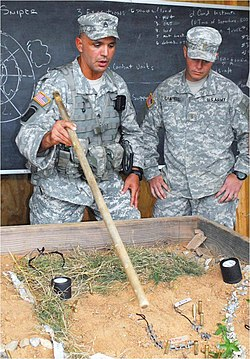

<div align="center">



# SANDKASTEN

**Open-source wargame simulation. NATO symbology. Real-world platform data. Continuous time or WeGo turns. Fog of war.**

*Named for the German military sand table used for operational planning.*


</div>

## Sandkasten

Sandkasten is a free, open-source wargame. You command naval and air forces on a tactical map of the Strait of Hormuz. You give orders. Your sensors report what they see. Missiles and air defence fight it out under fog of war. Run time continuously, or in WeGo turns where both sides plan and then watch the turn resolve.

**Play it free in your browser: https://csl-sandkasten.com**

### What you can do in v0.1.0

- Open the bundled Strait of Hormuz scenario or a real ADS-B snapshot
- Give orders: waypoints, throttle, targets, rules of engagement, sensor use
- Launch and recover aircraft from a carrier or airbase
- Create patrol, strike and intercept missions
- Run time continuously or in WeGo simultaneous turns
- Save a battle and resume it later
- Build your own scenario in the editor at /editor
- Read the platform manual at /database

### Credits

Designed by Ray Weiss, Conflict Simulations LLC.

Data and map credits: OpenStreetMap (ODbL) and OpenMapTiles via OpenFreeMap; EOX Sentinel-2 cloudless (CC BY-NC-SA 4.0); AWS Terrain Tiles; OurAirports (public domain); Natural Earth and NOAA ETOPO1 (public domain); Auftragstaktik (MIT); adsb.lol (ODbL); JetBrains Mono (SIL OFL 1.1).

---

## What Is This?

A tactical naval and air wargame. Command naval and air forces on a tactical map against scripted opponents. Radar detection, anti-ship missiles, SAM defense, fog of war. Continuous time with pause/play/speed controls.

Shares its map renderer and NATO symbology with [Auftragstaktik](https://github.com/lerugray/auftragstaktik), a tactical OSINT terminal. Sandkasten imports real-world snapshots from Auftragstaktik as playable scenario starting positions.

---

## Current State

### Title screen (`/`)
- `/` is a terminal title screen: SANDKASTEN, a plain explanation, the scenario menu (Hormuz standoff, real-world snapshot), BUILD YOUR OWN, PLATFORM MANUAL and ABOUT with v0.1.0 and the Ray Weiss credits. Arrow keys, 1-5 and Enter are keyboard-first; each entry opens the right scenario.

### Play View (Three.js terminal display)
- `/play` draws the theater in Three.js as a naval plot: Natural Earth coastline and depth contours, lat/long grid, range scale
- NATO MIL-STD-2525 glyphs with data blocks (name or track number, course, speed, flight level) that move aside so they don't overlap
- Track history dots, contacts fade as their data ages, radar sweeps on emitting units
- Missiles fly with trails and target lines; intercepts and hits flash briefly
- Drag to pan (it coasts when you let go), wheel to zoom at the cursor, `T` tilts the plot into a low 3D theater with NOAA relief, wireframe sensor domes and aircraft at altitude
- Terminal chrome: vendored JetBrains Mono, one phosphor green, one alarm red, function-key command bar, teletype traffic strip fed by the combat log, intel and autopause. The command bar's ABOUT button opens the credits card (SANDKASTEN v0.1.0, the Ray Weiss credits line, and the data/map credits); a small v0.1.0 tag sits in the top strip
- Keys: `B` briefing, `Space` pause, `1`-`6` speed, `S` sensors, `M` measure, `G` god mode, `T` tilt, `A` autopause, `H`/`?` help, `E` engage the chosen contact, `N` next contact, `R` cycle rules of engagement, `F` weapons free, `X` weapons hold
- The Hormuz mission is on screen from the first frame. A MISSION panel names the protected ship (USS Nimitz), the win condition (the living carrier enters the transit gate) and the loss condition (the carrier is destroyed), with its state and the distance to the gate edge; distance is information, only the game's own result counts. The real `transit-gate` polygon is drawn on the plot with a label. The panel, the briefing, the gate and the result are all read from the scenario's own events and reference points, so they cannot disagree with the rules. `B` or the BRIEFING button recalls the briefing (it pauses a running clock); `Esc` or `Enter` closes it. The briefing no longer closes on any stray key or click. GATE and NIMITZ in the panel (and SHOW GATE in the briefing) frame the gate or the ship
- When the scenario decides, the clock stops, ordering stops (Space, speed keys, ENGAGE, ROE, waypoint and throttle controls and map clicks do nothing), and the result card says which condition decided it, when, what was lost and destroyed, and the last events. PLAY AGAIN (or RESET at any time) returns to a fresh paused scenario with the briefing up, default fog of war (not GOD mode), no selection, no armed waypoint or measure mode and no leftover timers or listeners. Snapshot and legacy routes do not get the Hormuz objective
- The old MapLibre map stays at `/play?map=legacy` for comparison, and the retired MapLibre home map (static demo) stays at `/map`

### Foundation
- Dark tactical map with NATO MIL-STD-2525 symbols (editor, legacy play view)
- Demo scenario: US carrier strike group vs. Iranian naval forces, Strait of Hormuz. You win by taking the carrier into the transit gate; losing the carrier is a defeat. The loss is real: six Iranian Kaman missile boats hold a picket line across the direct approach, and a carrier that reaches it while every escort is still weapons tight is sunk before the gate. Do nothing, or send the carrier ahead alone, and you lose. Send the escorts ahead with ROE FREE, or take the carrier round the line, and you get through (SAND-THREAT-1, `docs/lane-reports/SAND-THREAT-1-REPORT.md`). Battle saves of the Hormuz scenario made before this change no longer load; snapshot saves do. Ship classes were fact-checked against a 2026-03-15 date
- Click units for detailed Info/Sensors/Weapons panels
- Shift+click to pin sensor range rings
- Sensor coverage overlay — toggle radar coverage circles (`S` key)
- Measurement tools — click two points for distance/bearing (`M` key)
- Dark/light theme (MapLibre pages; the terminal play view is dark only)
- Scenario editor at `/editor` — place units, drag to reposition, set sides, save/load JSON (LOAD checks the file and says so if it is not a scenario, for example a battle save). The editor now also creates, names, moves and deletes reference points (single points or 3+ corner areas, side-owned or scenario-level) drawn on the map, and authors victory conditions in plain words: destroy a unit, destroy any unit of a side, protect a unit, reach or hold a reference area, a time limit, and a score threshold. The conditions are compiled into the same TCA events the engine evaluates, so a scenario built from scratch in the editor plays to a real VICTORY and a real DEFEAT. PLAY hands the current scenario to the play screen (`/play?scenario=editor`); LOAD validates reference points and victory conditions with the same refusal style as the rest of the loader. Editor-built scenarios do not offer SAVE/LOAD BATTLE (battle files name built-in scenarios only)
- Platform manual at `/database`: 16 Hormuz platforms (ships and aircraft) with real open-license photos and credits, sourced specs, plain-English "what it is / how it is used / typical missions", sensors, weapons, defenses and a numbered bibliography. Records live in `src/data/platforms/records/`; the simulation reads them through `src/lib/platforms/lookup.ts`. Estimation methods are in `src/data/platforms/METHODS.md`.

### Real-world map (default `/play` plot, plus the MapLibre views `/map`, `/editor` and `/play?map=legacy`)
- Real geotagged facilities for the Hormuz theater: 869 sites (192 airfields, 347 heliports, 12 naval bases, 44 ports, 274 military areas) and 202 runways drawn to scale (real length and width; genuine parallel strips such as Bandar Abbas 03L/21R and 03R/21L are kept). Surveyed OpenStreetMap geometry alone decides how many strips an airfield has; an OurAirports chart record only attaches to the best-matching strip (same number, nearest centreline) and never adds a strip of its own. Strips tagged as under construction stay closed, carry no designator, and are never used as a spawn threshold. The length shown for a runway is the one its sources agree on (chart length, OSM `length` tag, drawn extent), so a rough-sketch outline never overrides a length two sources confirm; where nothing agrees the panel says the chart length is unverified. Built by `scripts/build-facilities.mjs` from OurAirports (public domain) and OpenStreetMap (ODbL) into `data/facilities/hormuz.json`; credits in `data/facilities/ATTRIBUTION.md` and on the map
- Distinct symbols per kind (airfield, heliport, naval base, port), military in amber and civil in grey; click one for a terminal-style detail panel (codes, elevation, runways with headings, surface and lighting, units based there). Selecting a unit shows its HOME BASE in the unit panel, with a link that jumps to the facility
- Units can carry a `homeBase` (facility and runway end). Aircraft held by a carrier or airbase now launch and recover through the air-operations model (see Simulation); a unit without an air wing simply starts on its runway threshold (the alert F-4 at Havadarya)
- Map toggles top-left: FACILITIES, GLOBE (globe when zoomed out, flat at tactical zoom), TERRAIN (AWS Terrain Tiles relief and hillshade), SAT (EOX Sentinel-2 cloudless, 2018, CC BY-NC-SA 4.0; the credit and licence show in the status bar and the map attribution while SAT is on). The dark basemap stays the default
- Base map: OpenFreeMap vector tiles (OpenStreetMap data, ODbL; OpenMapTiles schema). No account, no API key, no usage cap. The credit sits in the status bar and the map attribution control
- The default `/play` Three.js plot draws the same facilities in its phosphor style: symbols tiered by importance, runways to true length and width when zoomed in (at least 2 px wide when zoomed out), area outlines at close range, collision-checked name labels and runway-end designators. Labels are always English or transliterated (never Arabic or Persian script), sit clear of runway strips, other labels, grid labels and the scale bar, and thin out as you zoom out; a unit data block outranks a site label. The coast line and land fill fade out when you zoom in past their accuracy (the simplified coast is off by up to 1.3 km), so facility outlines never seem to cross water. The scale bar sits in the TRAFFIC header, so nothing covers it. Nothing overlaps: a label, data block, unit symbol, site icon and the scale bar never touch, and when a view is too dense the lower-priority data blocks and labels are hidden instead (a label that moves away from its icon always gets a leader line). Click a symbol or runway for the detail panel; the plot makes no tile requests

### OSINT layers and real-world snapshots
- Air defence, radar and nuclear sites for the Hormuz bbox: 9 AD sites, 3 radars, 2 nuclear sites, drawn with engagement or detection range rings in the default `/play` plot and in the MapLibre views. On the MapLibre views the toolbar strip and the credit footer sit beside the map instead of over it, site icons and labels draw above unit symbols without touching them, every label sits on a dark plate (readable on satellite) and is tied to its own icon, with a leader line when it has moved aside. Sites without a real name are called "<kind> near <nearest named place>". Click a site for its panel (system, side, range, ESTIMATED flag, platform-DB match, citations). Per-layer toggles AD, RADAR and NUC; rings are true geodesic circles, rings of 800 km or less always draw, the very large ones (Sepehr 3000 km, AN/TPY-2 1000 km) draw when selected. Dashed rings are ESTIMATED, solid ones come from the platform database
- Data comes from [Auftragstaktik](https://github.com/lerugray/auftragstaktik) (MIT, commit 7c5904e, copied into `data/osint/raw/` so the import runs offline) plus a curated supplement, because Auftragstaktik holds no air defence inside the Hormuz box. Supplement placements are anchored to real facilities and are scenario assumptions. Credits and licence text in `data/osint/ATTRIBUTION.md`. `npm run data:osint` regenerates `data/osint/hormuz.json` and the OSINT fields in `data/facilities/hormuz.json` (one record per real place, no duplicates)
- The platform database has no ground SAM or radar yet, so all 12 AD/radar sites are ESTIMATED misses; the importer matches them automatically once records exist. The platform database is not edited by the import
- Snapshot tool: `node scripts/snapshot-seed.mjs` (or SNAPSHOT in the editor) fetches live ADS-B from adsb.lol (keyless, ODbL; the tool limits itself to 1 request per second), maps military types found in the platform database to units and turns everything else into UNKNOWN contacts, then writes a scenario file the editor opens. AISStream needs an API key and is skipped; no key is stored in the repo. One example, fetched 2026-11-06T19:02:40Z, is committed in `data/snapshots/` and opens offline at `/play?scenario=snapshot`. It is titled "Hormuz air traffic, 6 November 2026, 19:02 UTC", has a short briefing, and you play it as a neutral observer in the normal player view: all 137 aircraft show in FORCES, on the plot and in the traffic line (GOD mode is off until you press G). The briefing is on screen when the scenario opens; it says every aircraft is listed under FORCES only when they are all on your side, and otherwise says how many are and that the rest show with GOD mode. Both the plot and the map credit "OSINT sites: Auftragstaktik"

### Simulation
- Real-time simulation at `/play`
- Waypoint-based movement with a STOP and four throttle settings; a unit that finishes its route holds position
- **Aircraft launch and recovery (SAND-AIR-1)** — a carrier or airbase holds an air wing counted by platform type. LAUNCH puts one aircraft on deck; after a short readiness delay it flies on the same movement, sensor and combat model as every other unit, with a fuel/endurance budget so a sortie must come home. RECOVER brings it back to its host, and turnaround (rearm/refuel) must elapse before it can launch again. A destroyed host loses its parked aircraft, and an airborne aircraft with no deck to land on diverts and is lost when its fuel runs out. Works in continuous time and WeGo, and saves/resumes mid-sortie
- Radar detection (range-based probability, radar horizon)
- ESM passive detection of active emitters
- Contact classification: Unknown → Detected → Classified → Tracked
- Fog of war — you see only what your sensors report; every side (not just yours) reasons from its own contacts
- God mode toggle to see all units (`G` key)
- Contacts degrade and fade without fresh sensor data; a weak ESM bearing cannot keep a stale track alive
- One authoritative game state: pausing, speed changes and orders no longer rewind the clock
- Time controls: pause/play, 1x through 60x speed
- Autopause on new contacts, damage, incoming weapons, intel messages (configurable)

### OPFOR AI
- Doctrine: ROE, engagement range, radar usage, evasion, withdrawal
- Missions: patrol, strike, CAP, escort, transit
- **Player missions (SAND-MISSIONS-1)** — the same mission model now drives your own units. Create a PATROL, STRIKE or INTERCEPT mission from the MISSIONS panel in the FORCES tab, click reference points on the plot, then assign your own ships or aircraft from the order panel — or LAUNCH a carrier/airbase aircraft straight onto the mission. A mission aircraft flies the mission and recovers aboard its host when the strike is done or fuel runs low, using the air-operations model. Works in continuous time and WeGo, and player missions survive save/resume. No change to OPFOR behaviour or scenario outcomes.
- Trigger-Condition-Action event scripting for scenario narratives
- Cascading doctrine: side → mission → unit overrides

### Combat
- **Player ENGAGE order** — pick a unit, a contact (DETECTED or better) and a weapon (or AUTO) in the order panel, then ENGAGE (`E`). Range, ammo, weapon domain and shooter state are checked the same way the AI is; a refusal says why. Only sensor knowledge is used, never true positions
- **Rules of engagement per unit** — WEAPONS HOLD / TIGHT / FREE (`X` / `R` / `F`). Default is TIGHT: a unit fires only in self-defence (a weapon in flight at it), at contacts classified hostile. FREE fires at any contact DETECTED or better
- **Cumulative damage** — each unit keeps a running damage total; damaged / mission-kill / destroyed come from the total (15% / 50% / 80% of the platform's damage points). Aircraft keep a separate one-hit rule (`AIRCRAFT_ONE_HIT_RATIO`)
- Defences are spent: chaff runs out, each try counts
- Anti-ship missile launch, flight, intercept
- Salvo sizing — ships fire 2-8 missiles based on the target's missile-defense channel count
- Weapon tracks on map — dashed lines showing missiles in flight
- SAM defense and CIWS point defense
- Damage: undamaged → damaged → mission-kill → destroyed
- Countermeasures: chaff, ECM, decoys
- Combat log with full event history
- **Victory and replay (SAND-VICTORY-1)** — the result now says which scenario rule ended the run, read from the event that actually fired (the result carries its source event, and the event that forced it, if any), not guessed from the result word. The briefing and the MISSION panel state each ending the player may know about (own-side losses, the clock, a score line, destroying a unit of your own side) in plain words; hidden triggers, hostile named targets, random chance and hostile areas are not stated, and the panel says OTHER ENDINGS NOT BRIEFED when any were left out. The debrief shows the final score beside the result and says whether the score decided the ending or is only a tally. Hormuz still reads as the transit pair (reach the gate / lose the carrier). Limits: a scenario with several end events is described rule by rule but the presenter never evaluates a rule itself; the result strip moved clear of the right column; the staged and selected contact now share one track number. No save or export (added later by SAND-SAVE-1, below).
- **Combat record (SAND-COMBAT-1)** — the COMBAT tab on `/play` holds the whole record of what involved your side: ALL ACTIVITY / COMBAT / INTEL, one own unit, and in WeGo ALL RUN or LAST RESOLVED TURN. Rows carry scenario-clock times and readable names (LAUNCH, DEFENDED, HIT, MISS, DAMAGED, LOST), stable source ids, explicit paging (`SHOWING X-Y OF Z`) and a CLEAR FILTERS action when a filter matches nothing. Enemies appear only as your contacts identify them (classified name, else track label, else UNKNOWN TRACK); incoming weapons read INCOMING WEAPON; GOD view adds visibly separate rows and they vanish when GOD goes off. A turn review and the debrief keep a short preview with the total and a VIEW RECORD button that returns to the held review or result; own units, lost ones included, can be inspected during REVIEW (orders stay locked). Turn membership uses event cursors taken at commit, and own damage uses the real undamaged / damaged / mission-kill / destroyed states, shown distinctly

### InfoWar Feed
- Game events produce simulated media coverage via local LLM ([Ollama](https://ollama.com))
- Personas: state media, wire services, OSINT analysts, pundits, civilians, troll farms
- Media channels match the scenario era — 1980s get radio and newspapers, 2020s get tweets and Telegram
- Game runs fine without Ollama; the Media tab stays empty

### Help System
- In-game help panel (press `?` or `H`)
- Covers controls, game concepts, sidebar guide, and media feed setup

### Testing
- Vitest unit tests (`npm run test:unit`) cover movement, sensors and contacts, combat and damage, engage and ROE, AI missions, event scripting, the simulation session and the demo's ship facts
- SAND-THREAT-1 specs (unit `hormuzThreat.test.ts`; E2E `tests/sand-threat-1-passive.spec.ts`): the shipped Hormuz scenario at 60x with seeded dice loses with no orders and with the carrier sent ahead alone, and wins with two different plans; the E2E plays a passive run through the UI to the real DEFEAT debrief. The E2E waits on the game clock, not the wall clock (it fails if the game passes T+4 h with no result), so a slow machine cannot turn the defeat into a timeout; `SAND_E2E_CPU_THROTTLE=4` runs it with the page CPU slowed four times. Unit proofs over 20 seeds show the result does not depend on the machine's frame time (SAND-THREAT-1 FIX3, `docs/lane-reports/SAND-THREAT-FIX3-REPORT.md`)
- An automated overlap check (`tests/sand-osint-1-overlap-plot.spec.ts`, `-overlap-map.spec.ts`; run with `SAND_E2E_GPU=1`) walks the plot and the map through every review view and fails if a label, data block, unit symbol, site icon or the scale bar touches another. `SAND_CAPTURE=1 SAND_E2E_GPU=1 npx playwright test tests/sand-osint-1-frames.spec.ts` regenerates the review screenshots (DPR 2, 1440x900 and 1920x1080) in `docs/verification/` and runs the same check on each frame
- `tests/sand-osint-1-overlap-map-loading.spec.ts` checks the `/map` view while a new view is still loading its base map (the tile host is answered locally and the tiles are held back, so it needs no tile server): nothing may overlap then either. `SAND_E2E_STUB_TILES=1` runs the `-overlap-map` spec the same way on a machine that cannot reach the tile server. The `/map` layout takes facility symbols from the facility data from zoom 9 and re-solves as soon as the symbols on screen change, so a site label no longer lies on an airport symbol until the tiles have arrived (unit `unit/map-layout-facilities.test.ts`)
- **Save and resume a battle (SAND-SAVE-1)** — SAVE BATTLE (top bar, and the debrief) pauses at one atomic checkpoint and hands the browser a versioned local file (`sandkasten-<scenario>-T+HHhMMm-<stamp>.sandsave.json`). LOAD BATTLE opens a file picker, checks the whole file, previews scenario, mission clock and result, and only then replaces the run on an explicit confirm. A restored battle always loads paused, on a fresh view: orders, damage, ammunition and defences spent, weapons in flight, both sides' contacts, fired events, messages, score, the AI's patrol and transit progress and the autopause settings all carry over; selection, targeting, God mode and every dialog reset, and the default fog applies. A finished battle stays finished (and keeps its deciding reason) until PLAY AGAIN. Save/load works for the Hormuz battle (continuous or WeGo) and the real-world snapshot, which stays neutral observation. The file names a built-in configuration by id and revision (rules revision, every simulation profile including the SIMFIX overrides, and the scenario/mission/event definition); a file from different rules or data, another version, another scenario, a truncated, oversized or malformed file, duplicate ids or dangling references are refused with a reason and leave the current battle untouched. Random combat is unchanged: a saved battle keeps its state, not a promise of the same dice. **Limits:** the generated InfoWar media feed is not saved (it starts empty after a load); the browser decides where a download goes, so the game says it handed over the file and cannot verify the disk write; no autosave, save slots, cloud storage, or arbitrary scenario import; v1 reads format version 1 only (no migration).
- SAND-SAVE-1 specs (`tests/sand-save-1-*.spec.ts`; unit `battleSave.test.ts`): a real play into a mid-battle checkpoint, download, closed tab, fresh page, load, resume to a real victory, a second plan from the same file, bad-file refusals, a defeat fixture, snapshot and legacy-route navigation, repeated loads and a network-free save/load; receipts under `docs/verification/sand-save-1-s409/`. On a machine without a GPU set `SAND_E2E_CHROMIUM=<chromium path> SAND_E2E_SWIFTSHADER=1`.
- SAND-PLAY-1 specs (`tests/sand-play-1-*.spec.ts`; run with `SAND_E2E_GPU=1`): the objective and briefing, a defeat and replay through the production combat path (a test-only `window.__SAND_E2E__` flag exposes the live session, never set in normal play), two different plans played through the ordinary UI to a real victory, and DPR 2 pixel checks at 1440x900 and 1920x1080 saved under `docs/verification/sand-play-1-s409/`
- SAND-MISSIONS-1 spec (`tests/sand-missions-1-flow.spec.ts`): the player creates and assigns PATROL / STRIKE / INTERCEPT missions in continuous time, in WeGo turns, and across a save/resume mid-mission
- Playwright E2E tests (`npm run test:e2e`) covering page loads, simulation gameplay, combat, autopause, and the terminal design system (vendored font, no remote fonts, chrome never resizes the plot)
- `npm test` runs the unit tests, then all E2E tests headless; `npm run test:ui` opens the visual debugger

---

## Setup

**You need:** [Node.js 18+](https://nodejs.org) and [Git](https://git-scm.com).

```bash
git clone https://github.com/lerugray/sandkasten.git
cd sandkasten
npm install
npm run dev
```

Open `http://localhost:3001` (port 3001 to avoid colliding with Auftragstaktik on 3000).

### Release build (static)

`npm run build` produces a fully static `out/` export (no server) for Cloudflare Pages. The three dev-only API routes (`/api/ollama/tags`, `/api/platforms`, `/api/snapshot`) are moved aside for the export build and restored afterwards, so `out/` ships no `/api/*` paths and the release makes zero server calls. The share card lives at `public/og-1200x630.png` (plus the square `og-1200x1200.png`), regenerated from a real in-game capture by `scripts/generate-og.mjs`. `npm run dev` keeps the API routes and the live-snapshot / local-LLM InfoWar features; those are hidden in the release behind `NEXT_PUBLIC_SAND_RELEASE`.

To run E2E tests (auto-starts the dev server):

```bash
npm test
```

### Platform Database

Sandkasten ships its own platform database (`src/data/platforms/`), compiled from public sources listed in each record. See `src/data/platforms/METHODS.md`.

### InfoWar Feed (Optional)

Install [Ollama](https://ollama.com), then:

```bash
ollama pull mistral
```

The Media tab connects automatically when Ollama is running.

---

## Tech Stack

- **Next.js 16** — TypeScript, Tailwind CSS
- **MapLibre GL JS** — tactical map (dark OpenFreeMap basemap, no key)
- **milsymbol** — NATO MIL-STD-2525 symbol rendering
- **Ollama** — local LLM for InfoWar media generation (optional)

---

## Project Structure

```
sandkasten/
├── src/
│   ├── app/                    # Next.js pages (/, /play, /editor, /database)
│   ├── components/
│   │   ├── map/                # TacticalMap, UnitLayer, RangeRings, DetailPanel
│   │   ├── game/               # Time controls, orders, intel, combat log
│   │   │   ├── infowar/        # InfoWar feed UI (media cards, status)
│   │   │   └── help/           # In-game help panel
│   │   └── editor/             # Scenario editor
│   ├── lib/
│   │   ├── map/                # Basemap styles, range ring geometry
│   │   ├── symbols/            # milsymbol factory with caching
│   │   ├── platforms/          # Platform database lookup
│   │   ├── scenarios/          # Scenario loader, demo scenario
│   │   ├── simulation/         # Sim engine, movement, detection, combat
│   │   ├── ai/                 # OPFOR doctrine, missions, TCA events
│   │   └── infowar/            # InfoWar engine, Ollama service, personas
│   └── types/                  # TypeScript interfaces
├── scripts/
├── data/                       # Data sources and build inputs
├── tests/                      # Playwright E2E tests
├── GDD.md                      # Game Design Document
├── TASKS.md                    # Development task breakdown
└── SESSION_NOTES.md            # Development log
```

---

## Development Roadmap

| Phase | Focus | Status |
|-------|-------|--------|
| **Foundation** | Map, NATO symbols, scenario editor, platform database | Complete |
| **Simulation** | Movement, radar detection, fog of war, time controls | Complete |
| **OPFOR AI** | Doctrine, missions, TCA event scripting | Complete |
| **Combat** | Missiles, SAM defense, damage, salvos, weapon tracks | Complete |
| **InfoWar Feed** | Media coverage from game events via local LLM | Complete |
| **Polish** | Autopause, god mode, sensors overlay, measurement, E2E tests | Complete |
| **Look** | Three.js terminal play view, motion, 3D tilt | Built, awaiting Ray's in-game review |
| **Platform database** | Own sourced records, photos and `/database` viewer for the Hormuz roster | Built, awaiting Ray's review; full roster is a later job |
| **Remaining gaps** | Aircraft altitude/climb model, magazine management | Next |
| **Save and resume** | Manual local battle files (Hormuz and snapshot), versioned and validated | Built (SAND-SAVE-1), awaiting Ray's review |
| **WeGo Multiplayer** | WebSocket sync, turn system, lobby, server-side fog of war | Planned |
| **OSINT** | Hormuz AD, radar and nuclear sites with true ranges, ADS-B snapshot to scenario | Built, awaiting Ray's review (AIS snapshots need a key, skipped) |
| **Release** | Static `out/` export for Cloudflare Pages, OG share card, title version and credits | Built (SAND-RELEASE-1) |
| **Community** | Scenario sharing, campaign mode | Planned |

See [TASKS.md](TASKS.md) for the full breakdown and [GDD.md](GDD.md) for design details.

---

## Related

- **[Auftragstaktik](https://github.com/lerugray/auftragstaktik)** — Tactical OSINT terminal. Shares the map renderer and NATO symbology. Sandkasten imports its real-world data as scenario starting positions.

---

## License

MIT

---

*Built with [Claude Code](https://claude.ai/claude-code).*
