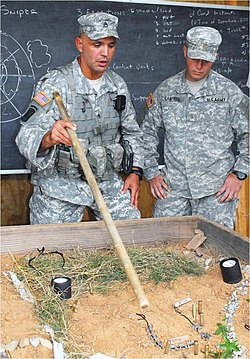

<div align="center">



# SANDKASTEN

**Open-source wargame simulation. NATO symbology. Real-world platform data. Continuous time or WeGo multiplayer. Fog of war. Community scenarios.**

*Named for the German military sand table used for operational planning.*


</div>

---

## What Is This?

A tactical wargame inspired by [Command: Modern Operations](https://www.matrixgames.com/game/command-modern-operations). Command naval and air forces on a tactical map against scripted opponents. Radar detection, anti-ship missiles, SAM defense, fog of war. Continuous time with pause/play/speed controls.

Shares its map renderer and NATO symbology with [Auftragstaktik](https://github.com/lerugray/auftragstaktik), a tactical OSINT terminal. Sandkasten imports real-world snapshots from Auftragstaktik as playable scenario starting positions.

### How It Differs From CMO

| | CMO | Sandkasten |
|---|---|---|
| **Cost** | $80+ | Free, open source |
| **Platform database** | Proprietary (CWDB), no photos | Our own, sourced and open: real licensed photos, full specs, plain-English briefings |
| **Scenario scripting** | Lua + complex editor | Visual trigger-condition-action system |
| **UI** | Built for defense analysts | Built for players |
| **Multiplayer** | TCP/IP real-time | WeGo simultaneous turns (planned) |
| **Real-world data** | None | OSINT snapshots via Auftragstaktik (planned) |

---

## Current State

### Play View (Three.js terminal display)
- `/play` draws the theater in Three.js as a naval plot: Natural Earth coastline and depth contours, lat/long grid, range scale
- NATO MIL-STD-2525 glyphs with data blocks (name or track number, course, speed, flight level) that move aside so they don't overlap
- Track history dots, contacts fade as their data ages, radar sweeps on emitting units
- Missiles fly with trails and target lines; intercepts and hits flash briefly
- Drag to pan (it coasts when you let go), wheel to zoom at the cursor, `T` tilts the plot into a low 3D theater with NOAA relief, wireframe sensor domes and aircraft at altitude
- Terminal chrome: vendored JetBrains Mono, one phosphor green, one alarm red, function-key command bar, teletype traffic strip fed by the combat log, intel and autopause
- Keys: `Space` pause, `1`-`6` speed, `S` sensors, `M` measure, `G` god mode, `T` tilt, `A` autopause, `H`/`?` help, `E` engage the chosen contact, `N` next contact, `R` cycle rules of engagement, `F` weapons free, `X` weapons hold
- The old MapLibre map stays at `/play?map=legacy` for comparison

### Foundation
- Dark tactical map with NATO MIL-STD-2525 symbols (home page, editor, legacy play view)
- Demo scenario: US carrier strike group vs. Iranian naval forces, Strait of Hormuz. You win by taking the carrier into the transit gate; losing the carrier is a defeat. Ship classes were fact-checked against a 2026-03-15 date (see `docs/handoffs/sim-fix-2026-11-03/NOTES.md`)
- Click units for detailed Info/Sensors/Weapons panels
- Shift+click to pin sensor range rings
- Sensor coverage overlay — toggle radar coverage circles (`S` key)
- Measurement tools — click two points for distance/bearing (`M` key)
- Dark/light theme (MapLibre pages; the terminal play view is dark only)
- Scenario editor at `/editor` — place units, drag to reposition, set sides, save/load JSON
- Platform manual at `/database`: 16 Hormuz platforms (ships and aircraft) with real open-license photos and credits, sourced specs, plain-English "what it is / how it is used / typical missions", sensors, weapons, defenses and a numbered bibliography. Records live in `src/data/platforms/records/`; the simulation reads them through `src/lib/platforms/lookup.ts`. Estimation methods are in `src/data/platforms/METHODS.md`. Nothing is copied from CMO.

### Real-world map (default `/play` plot, plus the MapLibre views `/`, `/editor`, `/play?map=legacy`)
- Real geotagged facilities for the Hormuz theater: 869 sites (192 airfields, 347 heliports, 12 naval bases, 44 ports, 274 military areas) and 202 runways drawn to scale (real length and width; genuine parallel strips such as Bandar Abbas 03L/21R and 03R/21L are kept). Surveyed OpenStreetMap geometry alone decides how many strips an airfield has; an OurAirports chart record only attaches to the best-matching strip (same number, nearest centreline) and never adds a strip of its own. Strips tagged as under construction stay closed, carry no designator, and are never used as a spawn threshold. The length shown for a runway is the one its sources agree on (chart length, OSM `length` tag, drawn extent), so a rough-sketch outline never overrides a length two sources confirm; where nothing agrees the panel says the chart length is unverified. Built by `scripts/build-facilities.mjs` from OurAirports (public domain) and OpenStreetMap (ODbL) into `data/facilities/hormuz.json`; credits in `data/facilities/ATTRIBUTION.md` and on the map
- Distinct symbols per kind (airfield, heliport, naval base, port), military in amber and civil in grey; click one for a terminal-style detail panel (codes, elevation, runways with headings, surface and lighting, units based there). Selecting a unit shows its HOME BASE in the unit panel, with a link that jumps to the facility
- Units can carry a `homeBase` (facility and runway end). The simulation has no takeoff or landing model, so a unit based on a runway simply starts on its threshold (the alert F-4 at Havadarya)
- Map toggles top-left: FACILITIES, GLOBE (globe when zoomed out, flat at tactical zoom), TERRAIN (AWS Terrain Tiles relief and hillshade), SAT (EOX Sentinel-2 cloudless, 2018, CC BY-NC-SA 4.0; the credit and licence show in the status bar and the map attribution while SAT is on). The dark basemap stays the default
- Base map: OpenFreeMap vector tiles (OpenStreetMap data, ODbL; OpenMapTiles schema). No account, no API key, no usage cap. The credit sits in the status bar and the map attribution control
- The default `/play` Three.js plot draws the same facilities in its phosphor style: symbols tiered by importance, runways to true length and width when zoomed in (at least 2 px wide when zoomed out), area outlines at close range, collision-checked name labels and runway-end designators. Labels are always English or transliterated (never Arabic or Persian script), sit clear of runway strips, other labels, grid labels and the scale bar, and thin out as you zoom out; a unit data block outranks a site label. The coast line and land fill fade out when you zoom in past their accuracy (the simplified coast is off by up to 1.3 km), so facility outlines never seem to cross water. The scale bar sits in the TRAFFIC header, so nothing covers it. Nothing overlaps: a label, data block, unit symbol, site icon and the scale bar never touch, and when a view is too dense the lower-priority data blocks and labels are hidden instead (a label that moves away from its icon always gets a leader line). Click a symbol or runway for the detail panel; the plot makes no tile requests

### OSINT layers and real-world snapshots
- Air defence, radar and nuclear sites for the Hormuz bbox: 9 AD sites, 3 radars, 2 nuclear sites, drawn with engagement or detection range rings in the default `/play` plot and in the MapLibre views. On the MapLibre views the toolbar strip and the credit footer sit beside the map instead of over it, site icons and labels draw above unit symbols without touching them, every label sits on a dark plate (readable on satellite) and is tied to its own icon, with a leader line when it has moved aside. Sites without a real name are called "<kind> near <nearest named place>". Click a site for its panel (system, side, range, ESTIMATED flag, platform-DB match, citations). Per-layer toggles AD, RADAR and NUC; rings are true geodesic circles, rings of 800 km or less always draw, the very large ones (Sepehr 3000 km, AN/TPY-2 1000 km) draw when selected. Dashed rings are ESTIMATED, solid ones come from the platform database
- Data comes from [Auftragstaktik](https://github.com/lerugray/auftragstaktik) (MIT, commit 7c5904e, copied into `data/osint/raw/` so the import runs offline) plus a curated supplement, because Auftragstaktik holds no air defence inside the Hormuz box. Supplement placements are anchored to real facilities and are scenario assumptions. Credits and licence text in `data/osint/ATTRIBUTION.md`. `npm run data:osint` regenerates `data/osint/hormuz.json` and the OSINT fields in `data/facilities/hormuz.json` (one record per real place, no duplicates)
- The platform database has no ground SAM or radar yet, so all 12 AD/radar sites are ESTIMATED misses; the importer matches them automatically once records exist. The platform database is not edited by the import
- Snapshot tool: `node scripts/snapshot-seed.mjs` (or SNAPSHOT in the editor) fetches live ADS-B from adsb.lol (keyless, ODbL; the tool limits itself to 1 request per second), maps military types found in the platform database to units and turns everything else into UNKNOWN contacts, then writes a scenario file the editor opens. AISStream needs an API key and is skipped; no key is stored in the repo. One example, fetched 2026-11-06T19:02:40Z, is committed in `data/snapshots/` and opens offline at `/play?scenario=snapshot`. It is titled "Hormuz air traffic, 6 November 2026, 19:02 UTC", has a short briefing, and you play it as a neutral observer in the normal player view: all 137 aircraft show in FORCES, on the plot and in the traffic line (GOD mode is off until you press G). The briefing is on screen when the scenario opens; it says every aircraft is listed under FORCES only when they are all on your side, and otherwise says how many are and that the rest show with GOD mode. Both the plot and the map credit "OSINT sites: Auftragstaktik"

### Simulation
- Real-time simulation at `/play`
- Waypoint-based movement with a STOP and four throttle settings; a unit that finishes its route holds position
- Radar detection (range-based probability, radar horizon)
- ESM passive detection of active emitters
- Contact classification: Unknown → Detected → Classified → Tracked
- Fog of war — you see only what your sensors report; every side (not just yours) reasons from its own contacts
- God mode toggle to see all units (`G` key)
- Contacts degrade and fade without fresh sensor data; a weak ESM bearing cannot keep a stale track alive
- One authoritative game state: pausing, speed changes and orders no longer rewind the clock
- Time controls: pause/play, 1x through 60x speed
- Autopause on new contacts, damage, incoming weapons, intel messages (configurable)

### OPFOR AI
- Doctrine: ROE, engagement range, radar usage, evasion, withdrawal
- Missions: patrol, strike, CAP, escort, transit
- Trigger-Condition-Action event scripting for scenario narratives
- Cascading doctrine: side → mission → unit overrides

### Combat
- **Player ENGAGE order** — pick a unit, a contact (DETECTED or better) and a weapon (or AUTO) in the order panel, then ENGAGE (`E`). Range, ammo, weapon domain and shooter state are checked the same way the AI is; a refusal says why. Only sensor knowledge is used, never true positions
- **Rules of engagement per unit** — WEAPONS HOLD / TIGHT / FREE (`X` / `R` / `F`). Default is TIGHT: a unit fires only in self-defence (a weapon in flight at it), at contacts classified hostile. FREE fires at any contact DETECTED or better
- **Cumulative damage** — each unit keeps a running damage total; damaged / mission-kill / destroyed come from the total (15% / 50% / 80% of the platform's damage points). Aircraft keep a separate one-hit rule (`AIRCRAFT_ONE_HIT_RATIO`)
- Defences are spent: chaff runs out, each try counts
- Anti-ship missile launch, flight, intercept
- WRA-based salvo sizing — ships fire 2-8 missiles based on target's missile defense
- Weapon tracks on map — dashed lines showing missiles in flight
- SAM defense and CIWS point defense
- Damage: undamaged → damaged → mission-kill → destroyed
- Countermeasures: chaff, ECM, decoys
- Combat log with full event history

### InfoWar Feed
- Game events produce simulated media coverage via local LLM ([Ollama](https://ollama.com))
- Personas: state media, wire services, OSINT analysts, pundits, civilians, troll farms
- Media channels match the scenario era — 1980s get radio and newspapers, 2020s get tweets and Telegram
- Game runs fine without Ollama; the Media tab stays empty

### Help System
- In-game help panel (press `?` or `H`)
- Covers controls, game concepts, sidebar guide, and media feed setup

### Testing
- Vitest unit tests (`npm run test:unit`) cover movement, sensors and contacts, combat and damage, engage and ROE, AI missions, event scripting, the simulation session and the demo's ship facts
- An automated overlap check (`tests/sand-osint-1-overlap-plot.spec.ts`, `-overlap-map.spec.ts`; run with `SAND_E2E_GPU=1`) walks the plot and the map through every review view and fails if a label, data block, unit symbol, site icon or the scale bar touches another. `SAND_CAPTURE=1 SAND_E2E_GPU=1 npx playwright test tests/sand-osint-1-frames.spec.ts` regenerates the review screenshots (DPR 2, 1440x900 and 1920x1080) in `docs/verification/` and runs the same check on each frame
- Playwright E2E tests (`npm run test:e2e`) covering page loads, simulation gameplay, combat, autopause, and the terminal design system (vendored font, no remote fonts, chrome never resizes the plot)
- `npm test` runs the unit tests, then all E2E tests headless; `npm run test:ui` opens the visual debugger

---

## Setup

**You need:** [Node.js 18+](https://nodejs.org) and [Git](https://git-scm.com).

```bash
git clone https://github.com/lerugray/sandkasten.git
cd sandkasten
npm install
npm run dev
```

Open `http://localhost:3001` (port 3001 to avoid colliding with Auftragstaktik on 3000).

To run E2E tests (auto-starts the dev server):

```bash
npm test
```

### Platform Database

Sandkasten ships its own platform database (`src/data/platforms/`); no CMO install is needed. Optional and local only: for CMO-derived reference data on your own machine (4,700 ships, 7,100 aircraft, 4,200 weapons, 7,200 sensors), install [Command: Modern Operations](https://store.steampowered.com/app/1076160/Command_Modern_Operations/) and run:

```bash
python scripts/extract_cmo_db.py
```

Reads CMO's SQLite database files, outputs JSON to `data/extraction/`. Gitignored, derived from proprietary game files. The game never reads or bundles it.

### InfoWar Feed (Optional)

Install [Ollama](https://ollama.com), then:

```bash
ollama pull mistral
```

The Media tab connects automatically when Ollama is running.

---

## Tech Stack

- **Next.js 16** — TypeScript, Tailwind CSS
- **MapLibre GL JS** — tactical map (dark OpenFreeMap basemap, no key)
- **milsymbol** — NATO MIL-STD-2525 symbol rendering
- **Ollama** — local LLM for InfoWar media generation (optional)
- **Python** — CMO database extraction (sqlite3, standard library)

---

## Project Structure

```
sandkasten/
├── src/
│   ├── app/                    # Next.js pages (home, /play, /editor)
│   ├── components/
│   │   ├── map/                # TacticalMap, UnitLayer, RangeRings, DetailPanel
│   │   ├── game/               # Time controls, orders, intel, combat log
│   │   │   ├── infowar/        # InfoWar feed UI (media cards, status)
│   │   │   └── help/           # In-game help panel
│   │   └── editor/             # Scenario editor
│   ├── lib/
│   │   ├── map/                # Basemap styles, range ring geometry
│   │   ├── symbols/            # milsymbol factory with caching
│   │   ├── platforms/          # Platform database lookup
│   │   ├── scenarios/          # Scenario loader, demo scenario
│   │   ├── simulation/         # Sim engine, movement, detection, combat
│   │   ├── ai/                 # OPFOR doctrine, missions, TCA events
│   │   └── infowar/            # InfoWar engine, Ollama service, personas
│   └── types/                  # TypeScript interfaces
├── scripts/
│   └── extract_cmo_db.py       # CMO database extraction
├── data/                       # Extracted platform data (gitignored)
├── tests/                      # Playwright E2E tests
├── GDD.md                      # Game Design Document
├── TASKS.md                    # Development task breakdown
├── DB_EXTRACTION_SPEC.md       # CMO database schema reference
└── SESSION_NOTES.md            # Development log
```

---

## Development Roadmap

| Phase | Focus | Status |
|-------|-------|--------|
| **Foundation** | Map, NATO symbols, scenario editor, platform database | Complete |
| **Simulation** | Movement, radar detection, fog of war, time controls | Complete |
| **OPFOR AI** | Doctrine, missions, TCA event scripting | Complete |
| **Combat** | Missiles, SAM defense, damage, salvos, weapon tracks | Complete |
| **InfoWar Feed** | Media coverage from game events via local LLM | Complete |
| **Polish** | Autopause, god mode, sensors overlay, measurement, E2E tests | Complete |
| **Look** | Three.js terminal play view, motion, 3D tilt | Built, awaiting Ray's in-game review |
| **Platform database** | Own sourced records, photos and `/database` viewer for the Hormuz roster | Built, awaiting Ray's review; full roster is a later job |
| **Remaining gaps** | Fuel consumption, aircraft altitude, game save/load | Next |
| **WeGo Multiplayer** | WebSocket sync, turn system, lobby, server-side fog of war | Planned |
| **OSINT** | Hormuz AD, radar and nuclear sites with true ranges, ADS-B snapshot to scenario | Built, awaiting Ray's review (AIS snapshots need a key, skipped) |
| **Community** | Scenario sharing, campaign mode | Planned |

See [TASKS.md](TASKS.md) for the full breakdown and [GDD.md](GDD.md) for design details.

---

## Related

- **[Auftragstaktik](https://github.com/lerugray/auftragstaktik)** — Tactical OSINT terminal. Shares the map renderer and NATO symbology. Sandkasten imports its real-world data as scenario starting positions.

---

## License

MIT

---

*Built with [Claude Code](https://claude.ai/claude-code).*
